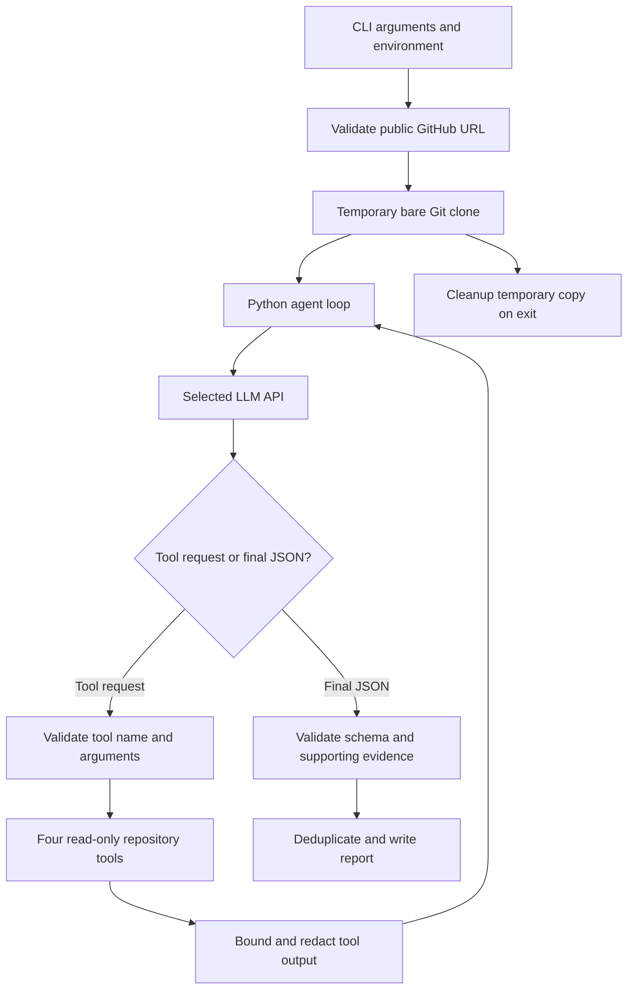

# DevOps Repository Auditing Agent

[](https://github.com/MasabTahir732/devops-repository-auditor/actions/workflows/ci.yml)

Current implementation and remaining account steps: [work status](WORK_STATUS.md).
See the [local validation record](docs/VALIDATION.md) and [publishing commands](docs/PUBLISHING.md).

A Python command-line agent that inspects a public GitHub repository and writes evidence-based DevOps findings to JSON. An LLM chooses among four read-only tools, observes their results, and decides what to inspect next. The control loop is written explicitly in Python; it uses no LangChain, LangGraph, n8n, or agent orchestration framework.

This project implements Assignment 2, **DevOps Repository Auditing Agent**. It does not train models or inspect ML datasets and experiments.

## Before your first run

The application needs Git, Python 3.11 or newer, internet access, and **one LLM API key**. Choose Gemini, Groq, or OpenAI. Gemini is the default; its configured Flash model has a free tier with account-specific limits. Groq offers a free plan as another option. OpenAI is optional and may incur charges. See [API setup and free options](docs/API_SETUP.md) for account links, current sources, and complete settings.

The LLM API lets the model choose tools and interpret their results. Public repository access uses Git over HTTPS, so this application does not need a GitHub API key. Do not paste credentials into GitHub, reports, screenshots, or chat.

Offline tests use temporary Git repositories and scripted model responses. Passing those tests verifies application behavior; it does not demonstrate the accuracy of a real model audit. Generate the required `sample_report.json` with a real run before submitting. A sample report is deliberately not invented or copied from mocked tests.

## Setup on Windows PowerShell

Run these commands from the project folder:

```powershell
Set-Location "D:\SEM 7\2. MlOps\devops-auditor"
python -m venv .venv
.\.venv\Scripts\python.exe -m pip install --upgrade pip
.\.venv\Scripts\python.exe -m pip install -r requirements-dev.txt
Copy-Item .env.example .env
notepad .env
```

If `.venv` already exists, skip its creation. If `.env` already contains your settings, edit it instead of overwriting it. Using the environment's Python executable directly avoids PowerShell activation policy changes.

For the default Gemini provider, set your own key in `.env`:

```dotenv
LLM_PROVIDER=gemini
GEMINI_API_KEY=your-own-key-goes-here
LLM_MODEL=gemini-3.8-flash
AUDIT_MAX_STEPS=40
AUDIT_TIMEOUT=60
AUDIT_CLONE_TIMEOUT=120
```

The key above is a placeholder. `.env` is ignored by Git; `.env.example` contains no credentials. A shell environment variable takes precedence over a value in `.env`. Use only the key for your chosen provider; [API_SETUP.md](docs/API_SETUP.md) shows Groq and OpenAI alternatives.

On macOS or Linux, use `python3 -m venv .venv` and `.venv/bin/python` in place of `.\.venv\Scripts\python.exe`.

To install the exact development versions recorded during validation, use `python -m pip install -r requirements-dev-lock.txt` in your virtual environment instead of the development requirements command above. `requirements-lock.txt` records runtime versions only.

After filling in `.env`, check local prerequisites without contacting the model:

```powershell
.\.venv\Scripts\python.exe scripts/check_setup.py
```

This checks Python, Git, installed dependencies, configuration, and key presence while hiding its value. It does not establish whether the key works. Add `--live` to make one small real tool-calling request; that request uses the provider's quota and does not perform a repository audit. See [API setup](docs/API_SETUP.md) for the complete sequence.

## Run an audit

Replace `owner/repository` with the public repository you want to inspect:

```powershell
.\.venv\Scripts\python.exe agent.py --repo https://github.com/owner/repository --output report.json
```

With an activated environment, the assignment's required command works unchanged:

```powershell
python agent.py --repo https://github.com/owner/repository --output report.json
```

Capture a trace to demonstrate how tool results influenced subsequent actions:

```powershell
.\.venv\Scripts\python.exe agent.py --repo https://github.com/owner/repository --output sample_report.json --trace sample_trace.jsonl
```

Inspect both files before submitting them. The trace records structured events; it is not a transcript of hidden model reasoning. Redaction is best effort, so review generated artifacts for credentials or sensitive values before publishing.

Available controls:

| Argument | Default | Purpose |
|---|---|---|
| `--repo` | Required | Public GitHub repository URL |
| `--output` | Required | Destination JSON report |
| `--trace` | Disabled | Optional JSON Lines trace |
| `--provider` | `LLM_PROVIDER`, otherwise `gemini` | Choose `gemini`, `groq`, or `openai` |
| `--model` | Selected provider's configured model | Override the model name |
| `--max-steps` | `40` | Bound the model interaction loop |
| `--timeout` | `60` seconds | Timeout for an individual API request |
| `--clone-timeout` | `120` seconds | Bound repository download time |

`--timeout` is not an overall audit deadline. A run may make several requests. Tool output is bounded to keep the agent's context and runtime manageable. Large or complex repositories may require a higher step budget, and limitations in a tool result must not be treated as proof that files are absent.

The process returns a nonzero exit status on fatal failures. A valid report containing violations is a successful audit, not a command failure. An empty list of violations means no supported findings were reported within this run's scope; it does not certify a repository as secure or defect-free.

## Architecture



The model receives tool definitions, auditing instructions, and the observations obtained so far. It requests an allowed function and supplies JSON arguments. Python performs the operation and returns its result. Follow-up tool calls are selected from new observations rather than scheduled as a fixed checklist. The basic `openai` Python SDK sends requests to the selected provider; our code owns the entire agent loop. OpenAI uses its Responses API. Gemini and Groq use their OpenAI-compatible Chat Completions endpoints. Their official guides describe this model/tool exchange: [OpenAI](https://developers.openai.com/api/docs/guides/function-calling), [Gemini](https://ai.google.dev/gemini-api/docs/openai), [Groq](https://console.groq.com/docs/tool-use/overview).

| Tool | Purpose |
|---|---|
| `list_files()` | Discover tracked files at the inspected commit |
| `read_file(path)` | Read bounded text with line numbers |
| `search_code(pattern)` | Search text for a literal, case-insensitive pattern |
| `git_log()` | Inspect bounded commit metadata/history |

Tools operate on Git objects from a temporary bare clone. They do not check out the target, install its dependencies, run its tests, execute its scripts, or modify the remote repository. The agent is not given a general shell tool.

## Audit scope

The agent investigates repository hygiene, dependency management, code quality, testing, CI/CD, security, configuration, collaboration, and build/release practices. Findings should account for project context and valid alternatives: for example, dependencies declared in `pyproject.toml` do not require a second `requirements.txt` declaration.

Evidence can support a repository-level absence, an explicit file location, or a relationship between files. The agent should read the relevant files before alleging mismatched commands or missing dependencies. It must not infer remote branch protection or claim it executed target tests from static repository contents.

## Report format

The report has exactly two top-level fields: `repository` and `violations`. Every violation supplies all of the following fields:

| Field | Meaning |
|---|---|
| `rule_id` | Stable identifier for the violated practice |
| `category` | Area of DevOps affected |
| `severity` | `critical`, `high`, `medium`, or `low` |
| `file` | Repository-relative path, or `null` for repository-wide absence |
| `line` | Positive, one-based line number, or `null` when inapplicable |
| `description` | Concrete problem and its consequence |
| `evidence` | Inspected facts supporting the claim, with secrets redacted |
| `recommendation` | Specific action to address the problem |

File and line references are checked against observations collected through the tools. Structural validation and evidence checks reduce unsupported output but cannot prove that every semantic conclusion is correct. Review descriptions, severities, false positives, and omissions before presenting a report as evaluated work.

## Verify the project

These checks do not need an API key:

```powershell
.\.venv\Scripts\python.exe -m pytest -q
.\.venv\Scripts\python.exe -m ruff check .
.\.venv\Scripts\python.exe -m build
```

After generating your real sample, run the submission structure check:

```powershell
.\.venv\Scripts\python.exe scripts/verify_submission.py
```

It checks required files, sample JSON structure, and a companion trace when present. A missing `sample_report.json` deliberately returns a nonzero result. It cannot establish that a saved report came from a real model or that its findings are correct.

The GitHub Actions workflow performs the project's checks when changes are pushed. Read the test names and assertions to distinguish tool/validation coverage from model detection accuracy. A real API run and manual review are still needed to evaluate the latter.

Three controlled source fixtures are provided under `tests/fixtures/`: `healthy`, `obvious-defects`, and `subtle-defects`. Their independently authored expectations live outside the audited source directories. Follow [the evaluation procedure](docs/EVALUATION.md) to publish each fixture as a public test repository and obtain real reports without exposing the expectations to the auditor.

Once a real report exists, compare it with the corresponding expectations:

```powershell
.\.venv\Scripts\python.exe scripts/evaluate.py --expected tests/fixtures/expectations/healthy.json --actual reports/healthy.json --output reports/healthy.metrics.json
```

The evaluator performs transparent location/category/keyword matching and reports precision, recall, misses, and unmatched findings. Its matching is a useful review aid; it cannot judge semantic correctness and its output is not a hidden-test benchmark score.

## Project map

| File or directory | Responsibility |
|---|---|
| `agent.py` | CLI, configuration, lifecycle, and exit handling |
| `repository.py` | URL validation and temporary Git repository access |
| `tools.py` | Required inspection tools |
| `llm_client.py` | Basic model SDK integration |
| `agent_loop.py` | Explicit observation/tool-call loop |
| `reporting.py` | JSON and evidence validation |
| `requirements.txt` | Runtime dependencies |
| `requirements-dev.txt` | Runtime and verification dependencies |
| `.env.example` | Configuration template without credentials |
| `docs/API_SETUP.md` | Required API, free provider options, and account setup |
| `tests/` | Offline application tests |
| `scripts/evaluate.py` | Compare reviewed expectations with a generated report |
| `scripts/check_setup.py` | Check local prerequisites; optionally make one live tool request |
| `scripts/verify_submission.py` | Check required artifacts and saved sample structure |
| `docs/EVALUATION.md` | Controlled fixture audit and evaluation procedure |
| `docs/LEARNING_GUIDE.md` | Walkthrough and viva preparation |
| `docs/ASSIGNMENT_CHECKLIST.md` | Requirements and final manual checks |

## Troubleshooting

| Symptom | What to check |
|---|---|
| `python` or `git` is not recognized | Install the tool and reopen PowerShell so its PATH updates |
| Missing API key | Set the chosen provider and its matching key in `.env`; see `docs/API_SETUP.md` |
| Authentication failure | Check that your key is valid and belongs to the intended API project |
| Model access failure | Choose a function-calling model available on the selected provider; update `LLM_MODEL` or use `--model` |
| Rate limit or quota failure | Check your API project's limits/billing; do not repeatedly restart an expensive run |
| Clone failure | Check the URL, public availability, network, and Git installation |
| Clone timeout | Retry a smaller repository or increase `--clone-timeout` |
| Step budget exhausted | Inspect the trace, then adjust `--max-steps` for the repository's size |
| Report rejected | Inspect the trace for missing evidence, malformed JSON, or unsupported file/line references |

Avoid sharing full diagnostic files until you have checked them for sensitive values.

## Submission and limitations

See [the assignment checklist](docs/ASSIGNMENT_CHECKLIST.md) for the remaining review steps. In particular, configure your own API access, produce an authentic sample report and trace, review detection quality on both problematic and healthy examples, and publish the project to a public GitHub repository before submitting its URL.

The auditor is a bounded static inspection assistant, not a vulnerability scanner with complete recall. Model conclusions can vary. It does not evaluate hosted repository settings, execute CI, prove dependency vulnerabilities, or guarantee that redaction detects every possible credential format. Only publish artifacts you have reviewed.
